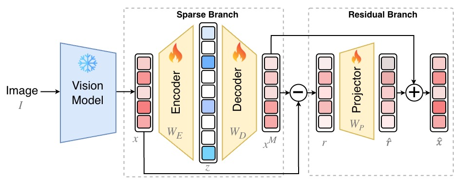

<div align="center">

[](https://arxiv.org/abs/2611.25165)
[](LICENSE)
[](https://www.python.org/)
[](https://pytorch.org/)

</div>

In a standard sparse autoencoder (SAE), one sparse code has to serve two objectives that are not guaranteed to align: **interpretability** and **reconstruction fidelity**. **DualSAE** separates them. The standard SAE becomes the **Sparse Branch**, which learns interpretable, semantic features; a plug-in **Residual Branch** models the non-semantic information that the sparse code leaves out; and a **decorrelation loss** keeps the two branches from overlapping. Across six SAE families, three vision encoders, two vision datasets and two language corpora, DualSAE improves both reconstruction fidelity and interpretability, and its more interpretable features carry over to topic modeling, hypothesis generation and LLM steering.

<p align="center">
  
</p>

<p align="center"><em><b>DualSAE architecture.</b> The Sparse Branch, a standard SAE, captures the semantic information of the input feature <code>x</code> in the sparse latent <code>z</code> and projects it back as <code>x^M</code>; the Residual Branch captures the non-semantic information <code>r_hat</code>. The final reconstruction is <code>x_hat = x^M + r_hat</code>.</em></p>

## ✨ Highlights

- **Plug-in for any SAE.** The Sparse Branch is an unchanged SAE: TopK, BatchTopK, JumpReLU, Matryoshka, Gated or CB-SAE.
- **Vision and language.** CLIP, SigLIP2 and ViT features of ImageNet-1K and OpenImagesV7, and Pythia residual-stream activations of OpenWebText and GitHub code.
- **Downstream applications.** SAE-based topic modeling, hypothesis generation and LLM steering.
- **Every experiment is reproducible.** Each table and figure of the paper and its supplementary material is produced by a script in this repository (see the [paper-to-code map](#-paper-to-code-map)).

## 🧩 Method

Given an input embedding $x$, the **Sparse Branch** is a standard SAE with sparsification rule $S(\cdot)$ (TopK, BatchTopK, JumpReLU, ...):

$$z = S(W_E x + b_E), \qquad x^M = W_D z + b_D .$$

The **Residual Branch** reads the residual $r$ and predicts the non-semantic part of the embedding through a projector $W_P$ and a nonlinearity $Q$; the final reconstruction adds the two branches:

$$r = x - x^M, \qquad \hat r = Q(W_P r), \qquad \hat x = x^M + \hat r .$$

Training minimizes

$$\mathcal{L} = \lVert x - \hat x \rVert_2^2 + \lambda \, \mathcal{L}_{\text{sparse}} + \gamma \, \lVert D_x^\top \hat r \rVert_2^2 ,$$

where $D_x = W_D[:, \mathcal{A}(x)]$ holds the decoder directions of the latents active for $x$. The **decorrelation loss** $\lVert D_x^\top \hat r \rVert_2^2$ keeps the Residual Branch from overwriting information that the active sparse features already represent. Hard-sparsity SAEs (TopK, BatchTopK) do not use $\mathcal{L}_{\text{sparse}}$. Training has **two stages**: the Sparse Branch is first trained alone as a standard SAE (warm-up), then both branches are trained jointly.

### Paper vs. code names

The code predates the paper's final terminology. Internal names are kept so that checkpoints and run configurations stay loadable; the command-line interface accepts the paper's names as aliases.

| Paper | Code |
|---|---|
| Sparse Branch, `x^M` | "mono" branch, `xM`, `W_enc` / `W_dec` / `b_dec` |
| Residual Branch, `r_hat = Q(W_P r)` | "poly" branch, `poly` module, `r_hat` |
| Decorrelation loss `L_dcor`, coefficient `gamma` | span-overlap penalty, `span_coef` (`--decorrelation_coef` alias) |
| Two-stage training, Stage 1 length | `--warmup_steps` |
| Sparsification rule `S(.)` | `--sparsity_mode {topk,batch_topk,jump_relu,matryoshka,gated,...}` |

## 📦 Installation

```bash
git clone https://github.com/AtlasAnalyticsLab/DualSAE.git && cd DualSAE
```

Python 3.11+ and a CUDA GPU are assumed. Each component pins its own dependencies (they differ: the downstream applications need vLLM, the language experiments need `transformers` model hooks):

```bash
pip install -r vision/requirements.txt          # core + all vision experiments
pip install -r <component>/requirements.txt     # any other component you want to run
```

## 🚀 Quick start

Download the encoder weights and datasets once (on a machine with internet access), extract CLIP features of ImageNet-1K, and train a Dual-BatchTopK SAE:

```bash
HF_HOME=./assets/hf DATA_ROOT=./data bash vision/prepare_assets.sh
cd vision
python extract_imagenet.py --model clip --split train
python extract_imagenet.py --model clip --split validation
python main.py --model dual --sparsity_mode batch_topk --dataset imagenet --extractor clip --seed 42 \
    --decorrelation_coef 0.005 --warmup_steps 17500 --dead_check_interval 100 --lr 1e-4 \
    --exp_name my_dual_btk --output_dir ./checkpoints
```

The run writes `checkpoints/my_dual_btk/` with the selected checkpoint (`best_val_monoscore_model.pt`) and its metrics (`best_metrics.json`: R², MonoScore, class purity, KNN and linear-probe accuracy). See [`vision/README.md`](vision/README.md) for all options, the baselines and the full grid.

## 🗂️ Repository layout

This repository contains the code for **every experiment in the paper** (main text and supplementary material), organized by domain. Each directory has its own README with installation, asset preparation, and the exact commands for each table and figure.

| Directory | Contents |
|---|---|
| [`vision/`](vision/) | Core library: all SAE baselines and DualSAE, training, feature extraction (ImageNet-1K, OpenImagesV7; CLIP, SigLIP2, ViT), the five metrics (R², MonoScore, class purity, KNN, linear probe), the main SAE-vs-DualSAE grid, parameter-matched baselines, and all vision ablations and analyses ([`vision/scripts/ablations/`](vision/scripts/ablations/)). |
| [`cb_sae/`](cb_sae/) | CB-SAE and CB-DualSAE: concept dissection, pruning and concept-bottleneck training on top of a Matryoshka / Dual-Matryoshka base. |
| [`language/`](language/) | SAEs and DualSAEs on language-model (Pythia) residual-stream activations of OpenWebText and GitHub code. |
| [`topic_modeling/`](topic_modeling/) | SAE-based topic modeling (built on SAE-TM, applied as a patch to the upstream repository). |
| [`hypothesis_generation/`](hypothesis_generation/) | SAE-based hypothesis generation with VLM-written latent descriptions (uses HypotheSAEs for scoring). |
| [`llm_steering/`](llm_steering/) | Steering Pythia with SAE / DualSAE decoder directions and evaluating the steered generations. |

All components import the models from `vision/` (`vision/models/`), so there is a single implementation of every SAE.

## 🔁 Reproducing the paper

### Assets and offline execution

Every download (datasets, encoder weights, language models, judges) lives in a separate `prepare_assets.sh` per component, so that training and evaluation can run on machines without internet access. Run the preparation script once on a machine with internet access, then run everything else offline (`HF_HUB_OFFLINE=1`, `TRANSFORMERS_OFFLINE=1`).

### Running experiments

All drivers are plain, sequential bash/python scripts with skip-if-done guards, so an interrupted grid can be re-launched and continues where it stopped. To use a cluster scheduler, wrap the single-cell commands (each driver documents its per-cell command) in your scheduler's job script; each component ships a `scripts/slurm_template.sh` with placeholders (e.g. [`vision/scripts/ablations/slurm_template.sh`](vision/scripts/ablations/slurm_template.sh)).

Some components consume the outputs of others; run them in this order:

1. `vision/` main grid (features, baselines, DualSAEs, selection) — everything else in vision builds on it.
2. `cb_sae/` — reads the Matryoshka / Dual-Matryoshka runs and the selection file written in step 1; its `cb_long.csv` is merged into the main table and radar figures by `vision/analysis/main/collect_main.py`.
3. `language/` — trains the language SAEs (including the extra runs used for steering: `--grid steering`) and, with `--stage textemb`, writes the corpora and document embeddings that `llm_steering/` reads.
4. `llm_steering/` — after step 3.

`topic_modeling/` and `hypothesis_generation/` train their own SAEs through `vision/main.py` and depend only on `vision/`.

Results are reported as mean ± standard deviation over seeds 42, 43, 44. Seeds are the only dimension that is averaged; every other dimension (encoder, dataset, activation, warm-up, gamma, K, ...) is reported separately. A baseline SAE is compared only with the DualSAE that uses the same sparsification rule (TopK vs. Dual-TopK, BatchTopK vs. Dual-BatchTopK, ...).

### 🧭 Paper-to-code map

The entry points below run each experiment end to end; the linked README lists the individual steps, options and outputs. Vision ablation paths are relative to [`vision/scripts/ablations/`](vision/scripts/ablations/README.md) (drivers) and `vision/analysis/ablations/` (table and figure builders).

**Main paper**

| Paper item | Entry point | Details |
|---|---|---|
| Sec. 3, motivation figure (class purity of retrievals with the reconstruction vs. the residual) | `figures/run_motivation.sh` | [vision ablations](vision/scripts/ablations/README.md) |
| Sec. 4, *Effect of warm-up length* | `warmup/run_warmup.sh` → `plot_warmup_curves.py` | [vision ablations](vision/scripts/ablations/README.md) |
| Sec. 5, *Comparison of SAE and DualSAE on ImageNet-1K* (radar) | `vision/scripts/main/run_main.sh` (+ `cb_sae/scripts/run_grid.sh` for the CB-SAE rows) → `vision/analysis/main/plot_radar.py` | [vision](vision/README.md), [cb_sae](cb_sae/README.md) |
| Sec. 5, *Improved interpretability of sparse latents* | `figures/run_matched_latents.sh` | [vision ablations](vision/scripts/ablations/README.md) |
| Sec. 5, *t-SNE visualization of sparse representations* | `figures/run_tsne_sparse.sh` | [vision ablations](vision/scripts/ablations/README.md) |
| Sec. 5, capacity analysis: *Parameter-matched SAE comparison* | `vision/scripts/param_matched/train_param_matched.py` → `vision/analysis/main/build_param_matched_table.py` | [vision](vision/README.md) |
| Sec. 5, residual analysis: *DualSAE vs. SAE with Residual Branch* | `grid/run_grid.py` → `collect_grid.py` → `plot_joint_vs_seq.py` | [vision ablations](vision/scripts/ablations/README.md) |
| Sec. 5, *Branch decomposition in DualSAE* (t-SNE and per-branch metrics) | `figures/run_branch_tsne.sh`; `branch_metrics/run_branch_metrics.py` → `plot_branch_bars.py` | [vision ablations](vision/scripts/ablations/README.md) |
| Sec. 5, *Effect of decorrelation loss on branch separation* | `figures/run_span_retrieval.sh` | [vision ablations](vision/scripts/ablations/README.md) |
| Sec. 5, *Effect of the expansion ratio* | `grid/run_grid.py` → `collect_scale_ablation.py` → `build_expansion_data.py` → `plot_expansion_main.py` | [vision ablations](vision/scripts/ablations/README.md) |
| Sec. 5, language representation: results table and qualitative latent figure | `language/run_pipeline.sh` → `language/build_language_table.py`; `language/scripts/make_figures.sh` | [language](language/README.md) |
| Sec. 5, downstream: *Image–topic assignment comparison* | `topic_modeling/scripts/run_all.sh` (figures: `06_figures.sh`) | [topic_modeling](topic_modeling/README.md) |
| Sec. 5, downstream: *Hypothesis generation* figure | `hypothesis_generation/scripts/run_all.sh` (figures: `04_figures.sh`) | [hypothesis_generation](hypothesis_generation/README.md) |

**Supplementary material**

| Paper item | Entry point | Details |
|---|---|---|
| Experimental details: hyper-parameters, datasets, vision encoders, metrics | `vision/configs/main_cells.json` (exact arguments of every run), `vision/extract_imagenet.py`, `vision/extract_open_images.py`, `vision/loss.py`, `vision/metrics.py`, `vision/branch_metrics.py` | [vision](vision/README.md) |
| Detailed results on ImageNet-1K and OpenImagesV7 (side-by-side table, OpenImagesV7 radar) | `vision/scripts/main/run_main.sh` + `cb_sae/scripts/run_grid.sh` → `vision/analysis/main/build_main_table.py`, `plot_radar.py` | [vision](vision/README.md), [cb_sae](cb_sae/README.md) |
| Input–reconstruction alignment | `figures/run_recon_alignment.sh` | [vision ablations](vision/scripts/ablations/README.md) |
| Class information in each branch on OpenImagesV7 | `branch_metrics/run_branch_metrics.py` → `plot_branch_bars.py` | [vision ablations](vision/scripts/ablations/README.md) |
| Ablation: coefficient of the decorrelation loss (R² and MonoScore tables) | `grid/run_grid.py` → `collect_span_ablation.py` → `make_gamma_tables.py` | [vision ablations](vision/scripts/ablations/README.md) |
| Ablation: decorrelation loss | `dcor/run_dcor.py` → `make_dcor_table.py` | [vision ablations](vision/scripts/ablations/README.md) |
| Ablation: projector of the Residual Branch | `grid/run_grid.py` → `collect_grid.py` → `make_grid_tables.py` | [vision ablations](vision/scripts/ablations/README.md) |
| Ablation: joint vs. sequential training (all settings, figure and table) | `grid/run_grid.py` → `collect_grid.py` → `plot_joint_vs_seq.py`, `make_grid_tables.py` | [vision ablations](vision/scripts/ablations/README.md) |
| Ablation: expansion ratio (ImageNet-1K and OpenImagesV7 figures) | `grid/run_grid.py` → `collect_scale_ablation.py` → `build_expansion_data.py` → `plot_expansion.py` | [vision ablations](vision/scripts/ablations/README.md) |
| Evaluation on language-model representations (setup, metrics, qualitative latent comparisons) | `language/run_pipeline.sh`; `language/scripts/make_figures.sh` | [language](language/README.md) |
| SAE as a topic model (table and image–topic figures) | `topic_modeling/scripts/run_all.sh` (table: `05_tables.sh`, figures: `06_figures.sh`) | [topic_modeling](topic_modeling/README.md) |
| SAE for hypothesis generation (table and class-level hypothesis figure) | `hypothesis_generation/scripts/run_all.sh` (table: `03_results.sh`, figures: `04_figures.sh`) | [hypothesis_generation](hypothesis_generation/README.md) |
| LLM steering (quantitative table and steering examples) | `llm_steering/run_all.sh` → `python -m steering.make_table`, `python -m steering.select_examples` | [llm_steering](llm_steering/README.md) |

Every table and figure is produced by a script from the run and evaluation outputs; no result values are stored in this repository.

## 📄 License

MIT (see [`LICENSE`](LICENSE)), except for third-party code, which keeps its own license (noted in the component READMEs).
